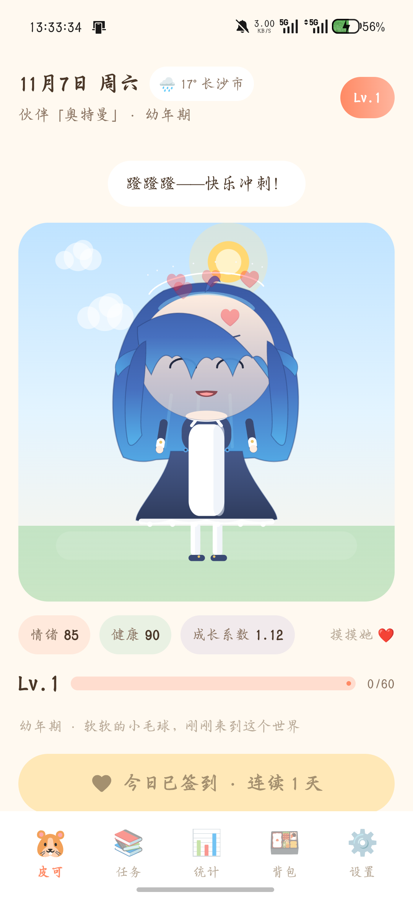
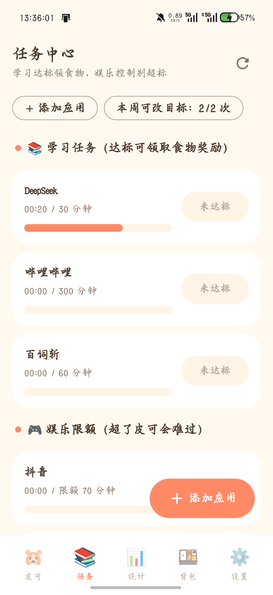
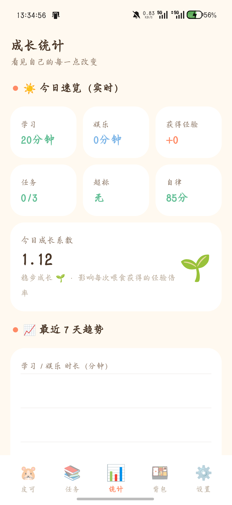
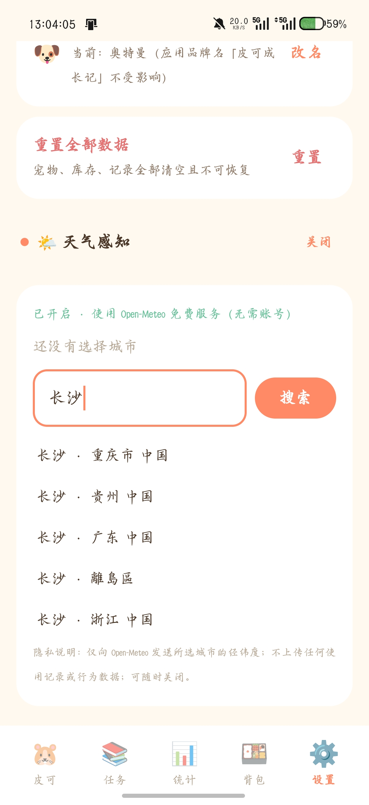

<div align="center">

# 🌟 星伴 · PetLife

**和你的专属伙伴一起成长**

一款把「真实自律」变成「宠物成长」的 Android 桌面伙伴应用

[](../../releases/latest)
[](../../releases/latest)
[](#%EF%B8%8F-%E6%B5%8B%E8%AF%95)
[](LICENSE)
[](https://kotlinlang.org)

*纯本地运行 · 无广告 · 无账号 · 天气为唯一可选联网功能*

</div>

---

## 📸 应用预览

| 🐹 伙伴主页 | 📚 任务中心 | 📊 成长统计 | ⚙️ 设置 |
|:---:|:---:|:---:|:---:|
|  |  |  |  |

> 伙伴形象、表情、动作全部为**程序化矢量实时绘制**（无任何图片素材），
> 会呼吸、会眨眼、眼神会追随你的手指，开心时转圈、害羞时捂脸、委屈时掉眼泪。

## 📲 下载安装

前往 **[Releases 页面](../../releases/latest)** 下载 `PetLife-vX.X.X-release.apk`，直接安装即可。

- 支持 Android 8.0（API 26）及以上，已在 Android 16 真机验证
- 覆盖安装自动保留全部数据
- 首次启动需在系统设置中授予「使用情况访问」权限（用于统计学习/娱乐时长，仅本地使用）

## ✨ 核心玩法

```
📱 真实学习（B站、百词斩、微信读书…时长达标）
        ↓ 领取食物奖励
🍱 喂养你的伙伴
        ↓ 经验 × 成长系数
🐣 她会升级、进化、换发型、换装扮
        ↺ 而娱乐超时会让她的情绪低落、自律评分下降
```

- **学习奖励**：自选学习应用并设定每日目标，真实前台时长达标即可领取食物（每应用每天一次，防重复领取）
- **娱乐限额**：给抖音/游戏设每日限额，超时会让伙伴不满——但永远温和，绝不惩罚致死
- **每日签到**：连续签到有里程碑奖励，漏签只清零连击
- **成长阶段**：幼年期 → 成长期 → 成年期 → 进化期，发型、鲸鱼尾、女仆头饰、星星发饰逐步解锁
- **成长系数 0.70–1.40**：任务完成率、签到、连击提升它；娱乐超标降低它——喂食经验随之增减
- **每周 2 次目标修改额度**：防止随手把目标改到形同虚设（周一凌晨自动恢复，防时间回拨）
- **天气感知**（可选，Open-Meteo 免费无密钥）：下雨提醒带伞、高温提醒补水，伙伴会主动聊天气
- **每日问候通知**（可选）：晚上 21:30，伙伴用一句话跟你说晚安

## 💬 会说话，但很有分寸

内置 **1349 条**原创中文话术（16 个情境分类：点击/开心/害羞/难过/困倦/时段问候/学习鼓励/娱乐提醒/喂食/签到/升级/进化/天气/闲聊/想念…），
配合 10 种表情与 26 个动作剪辑，由**对话调度器**统一裁决：

- 点击宠物 **100% 触发动作**，台词只以低概率出现——动作可以频繁，对话必须克制
- 全局冷却 + 分类独立冷却 + 最近台词窗口，杜绝复读机
- 升级/进化等重要反馈可打断闲聊，反之不行

## 🧮 数值系统（透明可解释）

```
成长系数 = 1.00 + 0.30×任务完成率 + 0.10签到 + 0.02×min(连签,10)
         − 0.05×超标应用数 − 0.10严重超标      → 限制在 [0.70, 1.40]

自律评分 = 100 − Σ超标惩罚(单应用≤25) − 5未签 − 15×未完成率 + 5全勤 → [0, 100]
```

每一次加减分都在「统计」页逐条展示——**你永远知道分数为什么变、变了多少**。

## 🏗️ 技术实现

| 模块 | 方案 |
|---|---|
| 语言 / UI | Kotlin 2.0 · Jetpack Compose · Material 3 深度定制暖色主题 |
| 角色渲染 | Compose Canvas 分层参数化立绘：15+ 独立图层、10 表情、26 动作剪辑、优先级动作状态机 |
| 数据 | Room（9 表）+ DataStore；结算幂等、防时间回拨、跨午夜正确归日 |
| 时长统计 | UsageStatsManager 事件流按本地日历日拆分 + 系统桶数据交叉合并 |
| 后台 | WorkManager：每日结算 + 时长刷新（最多回溯 14 天，漏开应用不丢数据） |
| 天气 | Open-Meteo（免费无密钥），30 分钟缓存、失败静默降级 |
| 测试 | JUnit 69 项：成长系数 / 自律评分 / 结算 / 签到 / 周额度 / 时长拆分 / 话术资产质量 / 调度器冷却与优先级 / 表情与阶段 |

### 🔐 隐私

- 养成核心 **100% 本地运行**，无广告、无账号、无埋点
- 天气为唯一可选联网功能（默认关闭）：仅向 Open-Meteo 发送所选城市经纬度
- 仅需两条权限：`PACKAGE_USAGE_STATS`（系统特殊权限，手动授予）与 `QUERY_ALL_PACKAGES`

## 🛠️ 构建

```bash
git clone https://github.com/Yangxbao/PetLife.git
cd PetLife
./gradlew assembleDebug          # 产出 app/build/outputs/apk/debug/
./gradlew testDebugUnitTest      # 运行 69 项单元测试
```

- 需要 JDK 17 与 Android SDK（compileSdk 35）
- 签名密钥 `petlife-release.jks` 不随仓库分发；无密钥时 release 以未签名形式构建，debug 可完整体验

## ⭐ 如果你喜欢这个项目

给个 Star 就是给小毛球喂了一颗小苹果 🍎

## 📄 License

[MIT](LICENSE)
